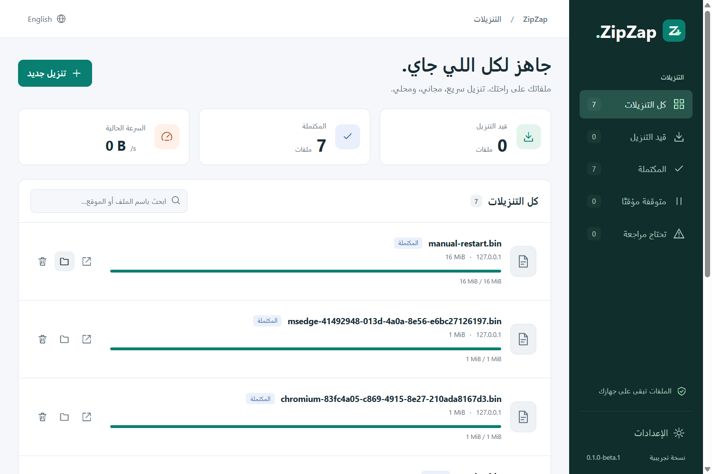

# ZipZap

[](LICENSE)

A free, open-source download manager focused on reliable downloads, safe resume,
and a straightforward desktop experience. Windows first, with a Rust engine and
a Tauri interface.

**Status: [0.1.0-beta.1](https://github.com/Lord-shaban/ZipZap/releases/tag/v0.1.0-beta.1)
is available for Windows 11 x64. This beta is unsigned; verify the published
SHA-256 checksums before installing.**

[العربية](docs/README.ar.md) · [Roadmap](docs/ROADMAP.md) ·
[Project tracker](https://github.com/users/Lord-shaban/projects/12) ·
[Contributing](CONTRIBUTING.md)

The [next development phase](docs/planning/NEXT_PHASE.md) is prepared for a
daily-use beta: recovery, durable queue/scheduling, desktop completion and
release qualification. [الخطة بالعربية](docs/planning/NEXT_PHASE.ar.md).
These are planned tasks, separate from the published first beta.

## First-beta capabilities

- HTTP/HTTPS downloads with bounded parallel connections when supported.
- Pause, safe resume after restart, queue management, and bandwidth control.
- A Windows desktop interface in English and Arabic, including RTL support.
- Explicit “Download with ZipZap” actions in Chrome and Edge.
- Local download history and settings, with no account or hosted service required.

Automatic
browser interception, media extraction, scheduling by time, macOS, and Linux are
outside the first beta. See [scope and acceptance criteria](docs/PRODUCT.md).

## Stack

| Component           | Direction                                                                                            |
| ------------------- | ---------------------------------------------------------------------------------------------------- |
| Download engine     | Rust with Tokio/reqwest; [decision and evidence](docs/architecture/0002-download-engine-strategy.md) |
| Desktop application | Tauri 2, Svelte, TypeScript, Vite                                                                    |
| Persistent state    | SQLite                                                                                               |
| Browser integration | TypeScript, Manifest V3, native messaging                                                            |
| Collaboration       | GitHub Issues, Projects, pull requests, and Actions                                                  |

The [architecture decision](docs/architecture/0001-project-direction.md) records
the boundaries, tradeoffs, and decisions still to be made. Download speed depends
on the server, network, disk, and workload; measurements will precede claims.

## Work on the repository

Use Node.js 24 (the pinned version is in [.node-version](.node-version)) and npm:

```sh
git clone https://github.com/Lord-shaban/ZipZap.git
cd ZipZap
npm ci
npm run check
```

Verification runs locally. Hosted GitHub checks are manual-only by
[maintainer decision](https://github.com/Lord-shaban/ZipZap/issues/54).

Run `node scripts/build-native.mjs` then `npm run desktop:dev` on Windows.
See [development setup](docs/development/SETUP.md) for native prerequisites,
[the user guide](docs/USER_GUIDE.md) for app/browser usage, and
[core behavior](docs/development/ENGINE.md) for recovery and filesystem limits.
The [historical engine probe](experiments/engine-strategy/README.md) is isolated
from the production application.

## Find your way

| Document                                                    | Purpose                                                        |
| ----------------------------------------------------------- | -------------------------------------------------------------- |
| [Product scope](docs/PRODUCT.md)                            | Users, first-beta requirements, and explicit exclusions        |
| [Roadmap](docs/ROADMAP.md)                                  | Ordered milestones, issues, and completion gates               |
| [Next phase](docs/planning/NEXT_PHASE.md)                   | Daily-use beta scope, dependencies, research and release gates |
| [Architecture](docs/architecture/0001-project-direction.md) | Stack, component ownership, and data flow                      |
| [Development workflow](docs/development/WORKFLOW.md)        | Issue → branch → PR → checks → merge                           |
| [Verification](docs/development/VERIFICATION.md)            | Current checks and future application test requirements        |
| [Release process](docs/development/RELEASING.md)            | Evidence required before a public release                      |
| [Research protocol](docs/research/README.md)                | Evidence-based investigation with REA                          |

Report reproducible bugs through [Issues](https://github.com/Lord-shaban/ZipZap/issues).
Use [Discussions](https://github.com/Lord-shaban/ZipZap/discussions) for questions
and ideas. Report security vulnerabilities [privately](SECURITY.md).

## License and attribution

ZipZap is licensed under the [MIT License](LICENSE). Contributions are accepted
under the same license. See [dependency notices](THIRD_PARTY_NOTICES.md);
packaging includes transitive license texts and required MPL source archives.
The repository license does not replace dependency terms.

ZipZap is an independent project inspired by the download-manager workflow. It
is not affiliated with Internet Download Manager or Tonec.

## Desktop preview

Actual Windows WebView2 interface in Arabic, showing local verification downloads:


