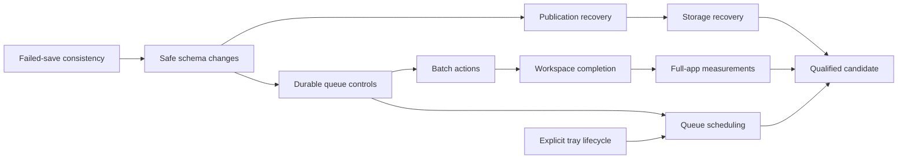

# Next development phase: daily-use beta

Prepared 2026-10-17 in [#27](https://github.com/Lord-shaban/ZipZap/issues/27).
[العربية](NEXT_PHASE.ar.md) · [Feature study](../research/next-phase-features.md) ·
[Tracking epic #28](https://github.com/Lord-shaban/ZipZap/issues/28) ·
[M6 milestone](https://github.com/Lord-shaban/ZipZap/milestone/7) ·
[Development Project](https://github.com/users/Lord-shaban/projects/12)

## Outcome and current truth

Release decision, 2026-10-20: the maintainer authorized publication of
`0.2.0-beta.1` with the quantitative cold-start/painted-readiness gap retained in
#46. Required local and protected release checks still apply. This narrow beta
delivery exception does not close #46 or declare the complete M6 exit gate met;
see the [qualification record](../development/DAILY_USE_QUALIFICATION.md).

On 2026-10-21 the maintainer further authorized immediate beta publication after
installed-browser qualification stalled. The release uses an explicit, disclosed
version-specific exception; failed/cancelled checks remain unchanged. #82 and
full #47 native/browser qualification remain open alongside #46.

Current delivery: [0.2.0-beta.1](../releases/0.2.0-beta.1.md) includes the
implemented #29–#45 work. The paragraphs below preserve the original planning
snapshot; use the roadmap and issue tracker for live status. #46 and full M6
qualification remain open.

Prepare ZipZap for everyday direct HTTP(S) downloads on Windows 11 x64, with
strong recovery, useful queue/schedule controls and a complete classic desktop.
The proposed candidate version is **0.2.0-beta.1**; this is a planning target,
not a version bump, release date or promise that work is shipped.

- **Published:** 0.1.0-beta.1, with its original core/browser/installer evidence.
- **Merged but unreleased:** the history-removal fix (#23/#24) and classic
  workspace (#25/#26). Baseline main commit: `5905271`.
- **Accepted M6:** the 19 required deliverables below, including release
  qualification. Every implementation issue is initially Todo.
- **Decision-only M7:** four studies, separate from the M6 exit gate. A study
  can finish with no-go; implementation needs a newly scoped issue/decision.

Planning itself does not implement a product feature. Public IDM descriptions,
source observations, REA artifact inventory and test results remain distinct in
the [study](../research/next-phase-features.md).

## Scope and architecture

Keep one Rust Manager for transfer state, retry, queue order, scheduling and
persistence; all desktop/browser/headless entry points share its validation.
Tauri owns Windows lifecycle/dialogs/provenance; Svelte owns presentation and
localized interaction. Reuse SQLite and the existing native messaging bridge.
Do not introduce another downloader, daemon, cloud service, generic rule engine
or engine/plugin abstraction as incidental preparation.

M6 uses **one queue**. Queue sorting in the table and download dispatch order
are separate. Scheduling works while the app is running, including the user's
explicit tray mode; it does not wake a sleeping/off machine. Custom categories
suggest folders for new jobs and never move existing files. Downloaded files
are never automatically executed or overwritten.

Before a new persisted/protocol/lifecycle boundary is coded, record the narrow
choice in the issue or an ADR when consequential. An unresolved choice is not
permission to invent a generalized subsystem. New dependencies need an actual
capability gap, license/package review and a smaller-option comparison.

## Required work, in execution order

Issue links own live acceptance criteria and blockers; this table owns the
phase sequence. Native GitHub blocked-by relationships mirror the prerequisites.
Sizes are relative: **M** is a focused change crossing existing paths; **L**
needs several reviewable slices. They are not calendar estimates.

| Gate | Issue                                                  | Deliverable                                                                        | Size | Depends on                          |
| ---- | ------------------------------------------------------ | ---------------------------------------------------------------------------------- | ---- | ----------------------------------- |
| G0   | [#29](https://github.com/Lord-shaban/ZipZap/issues/29) | establish a real Windows baseline for the classic workspace                        | M    | Planning merged                     |
| G0   | [#30](https://github.com/Lord-shaban/ZipZap/issues/30) | keep live download state consistent when persistence fails                         | M    | Planning merged                     |
| G0   | [#31](https://github.com/Lord-shaban/ZipZap/issues/31) | migrate saved state safely for next-beta fields                                    | M    | #30                                 |
| G0   | [#32](https://github.com/Lord-shaban/ZipZap/issues/32) | reconcile a completed file after a publication-state crash                         | M    | #30, #31                            |
| G0   | [#33](https://github.com/Lord-shaban/ZipZap/issues/33) | recover clearly from disk-space and destination failures                           | M    | #30, #32                            |
| G1   | [#34](https://github.com/Lord-shaban/ZipZap/issues/34) | classify download failures and respect bounded retry delays                        | M    | #30                                 |
| G1   | [#35](https://github.com/Lord-shaban/ZipZap/issues/35) | suggest safe server filenames and resolve duplicate destinations                   | M    | #31, #34                            |
| G1   | [#36](https://github.com/Lord-shaban/ZipZap/issues/36) | replace expired download links without mixing file representations                 | M    | #31, #34, #35                       |
| G1   | [#37](https://github.com/Lord-shaban/ZipZap/issues/37) | add durable queue ordering and explicit start-stop controls                        | M    | #31, #34                            |
| G2   | [#42](https://github.com/Lord-shaban/ZipZap/issues/42) | schedule one queue with explicit local-time behavior                               | L    | #37, #41                            |
| G2   | [#38](https://github.com/Lord-shaban/ZipZap/issues/38) | preview multiple links and apply safe selected-file actions                        | M    | #37, #35                            |
| G2   | [#39](https://github.com/Lord-shaban/ZipZap/issues/39) | customize filename categories and suggested save folders                           | M    | #31, #35                            |
| G2   | [#40](https://github.com/Lord-shaban/ZipZap/issues/40) | finish classic desktop navigation and saved appearance preferences                 | M    | #29, #31, #38                       |
| G1   | [#41](https://github.com/Lord-shaban/ZipZap/issues/41) | keep downloads running in the Windows tray by explicit choice                      | M    | #30, #31                            |
| G2   | [#43](https://github.com/Lord-shaban/ZipZap/issues/43) | report whether a browser request was queued or rejected by the app                 | M    | #29, #35, #37                       |
| G2   | [#44](https://github.com/Lord-shaban/ZipZap/issues/44) | preserve Windows trust checks for files downloaded from the internet               | M    | #32, #35                            |
| G2   | [#45](https://github.com/Lord-shaban/ZipZap/issues/45) | show actionable recovery details and export a redacted support summary             | M    | #34, #33, #36, #43                  |
| G3   | [#46](https://github.com/Lord-shaban/ZipZap/issues/46) | measure full-app performance and decide whether adaptive segmentation is justified | M    | #29, #40, #43                       |
| G3   | [#47](https://github.com/Lord-shaban/ZipZap/issues/47) | qualify and prepare the next Windows beta for daily use                            | L    | All other M6 deliverables (see #47) |

The parent epic is a progress container, not another implementation layer.
Start with **[#29](https://github.com/Lord-shaban/ZipZap/issues/29) and [#30](https://github.com/Lord-shaban/ZipZap/issues/30)**: one establishes the actual
Windows baseline, the other reproduces and fixes source-identified persistence
failure paths. No feature work has been started by this planning task.

### Gates

1. **G0 — Protect existing work:** real native baseline, consistent failed-save
   behavior, safe schema upgrades, publication recovery and storage failures.
   A blocking defect found in the baseline must have a linked issue and evidence.
2. **G1 — Make the engine controls useful:** bounded classified retries, safe
   metadata/naming, explicit expired-link replacement, durable queue control and
   an explicit tray lifecycle. Reuse validated resume rather than asserting
   identity from filename/size or an unrelated server's ETag.
3. **G2 — Complete daily workflows:** one-queue scheduling, selected/batch actions,
   editable category suggestions, saved accessible desktop preferences, honest
   browser enqueue feedback, Windows provenance and redacted support details.
4. **G3 — Qualify one candidate:** full-app measurement, explicit performance
   decisions and release-candidate evidence at the same reviewed commit.

Selected dependency chains (each linked issue retains its full prerequisites):



## Separately gated research

[M7](https://github.com/Lord-shaban/ZipZap/milestone/8) groups decisions, not a second promised
feature release. Each study records exact versions, owned/public fixtures,
permissions, dependencies, implementation cost, a go/no-go and remaining
unknowns. Do not turn a favorable public marketing page into runtime evidence.

| Issue                                                  | Question                                                        | Needed before implementation                                                                          |
| ------------------------------------------------------ | --------------------------------------------------------------- | ----------------------------------------------------------------------------------------------------- |
| [#48](https://github.com/Lord-shaban/ZipZap/issues/48) | Automatic browser handoff and user-invoked page-link collection | Separate ownership/failure/optional-permission decisions on actual Chrome/Edge versions.              |
| [#49](https://github.com/Lord-shaban/ZipZap/issues/49) | Authenticated file and proxy support                            | Explicit origin/secret-storage/redirect threat model; cookie forwarding remains a separate decision.  |
| [#50](https://github.com/Lord-shaban/ZipZap/issues/50) | Firefox compatibility and browser-store packaging               | Exact identity/native-host evidence and signing/account/review requirements; no store submission now. |
| [#51](https://github.com/Lord-shaban/ZipZap/issues/51) | Unprotected media formats and assembly                          | Format/muxing/license/cancellation decision, bounded corpus and supported-site/format limits.         |

Adaptive segmentation is a go/no-go deliverable of [#46](https://github.com/Lord-shaban/ZipZap/issues/46), after
measurement. It is not an automatic engine rewrite. Named/synchronization
queues, bandwidth quotas, FTP/torrents, website crawling, cloud sync, other OSes,
OS wake/shutdown and arbitrary post-download commands remain outside M6.
Automatic updates remain deferred pending separately qualified trust/rollback.

## Definition of done and verification

For every implementation issue:

- Read its callers, configuration, tests and affected English/Arabic docs first.
  Implement the smallest complete behavior through the shared core.
- Demonstrate meaningful success, failure and retry/cancellation cases. Keep
  boundary validation, accessible keyboard interaction, no-clobber output and
  private-URL redaction intact. Do not add tests that only repeat constants.
- Record actual commands, versions, commit and results. A planned scenario,
  mocked IPC test and native Windows result are different kinds of evidence.
- Use a short-lived branch/PR. One active implementation issue per contributor;
  blocked tasks remain Todo, never Done just because a design was written.

`npm run check` is required locally. Rust changes also require:

```sh
cargo fmt --all -- --check
cargo clippy --workspace --all-targets --locked -- -D warnings
cargo test --workspace --locked
cargo build --workspace --locked
node experiments/engine-strategy/compare.mjs
node scripts/test-engine.mjs
```

Run UI/browser/installer checks where the changed behavior reaches those paths.
Use isolated state, destinations and browser profiles, never a personal history
or replacement of the normal native-host registration. REA is used only when a
specific shipped artifact/runtime question requires it; ordinary source analysis
uses normal tools. Private artifacts remain in ignored local research storage.

**Hosted checks:** no GitHub Actions are run during this planning task, following
the maintainer's instruction. This does not label hosted checks passed, weaken
validation requirements for future code, or permanently change branch protection.
Future implementation/release runs and any explicit waiver must be recorded.

## Release gate and rollback

[#47](https://github.com/Lord-shaban/ZipZap/issues/47) owns the candidate, not this planning task. All required
children and blocking defects must have evidence at one reviewed commit. Verify
beta.1-to-candidate schema and installer upgrade, repair, uninstall/reinstall,
retained completed files/partials, queue/schedule/tray semantics, actual browser
handoff and downloaded-file SHA-256 values. Include security/privacy/dependency
review, bilingual docs/release notes, notices and checksum manifests.

A migration failure leaves the prior recoverable state. Newer-schema rejection
must be explicit; do not promise an old binary can read a changed database.
Document a tested recovery path before distribution. Authenticode availability,
update signatures and Windows provenance are separate concerns. If signing is
unavailable, record that distribution decision and the unsigned limitations;
no account purchase, key creation or OS-warning bypass is assumed.

The maintainer separately authorizes publication after reviewing candidate
artifacts and evidence. M6 is complete only when its stated delivery gate is
met; M7 study completion is not required. Scope removal needs an explicit linked
change to this plan/epic, not silently closing an incomplete task.

## Operational risks and scope controls

| Risk                                               | Control and owning work                                                                                                                                                                                                                      |
| -------------------------------------------------- | -------------------------------------------------------------------------------------------------------------------------------------------------------------------------------------------------------------------------------------------- |
| Live/durable state diverges on storage failure     | [#30](https://github.com/Lord-shaban/ZipZap/issues/30), [#31](https://github.com/Lord-shaban/ZipZap/issues/31), [#32](https://github.com/Lord-shaban/ZipZap/issues/32): deterministic fault/retry/reopen evidence before dependent features. |
| Resume appends bytes from another representation   | [#36](https://github.com/Lord-shaban/ZipZap/issues/36): conservative identity proof or explicit safe restart.                                                                                                                                |
| Queue/scheduler races create duplicate workers     | [#37](https://github.com/Lord-shaban/ZipZap/issues/37), [#42](https://github.com/Lord-shaban/ZipZap/issues/42), [#41](https://github.com/Lord-shaban/ZipZap/issues/41): one Manager, durable gate and once-only clock transitions.           |
| New browser/diagnostic data exposes private links  | [#43](https://github.com/Lord-shaban/ZipZap/issues/43), [#45](https://github.com/Lord-shaban/ZipZap/issues/45): versioned bounded responses, exact origin checks and adversarial redaction.                                                  |
| Visual completion is mistaken for native readiness | [#29](https://github.com/Lord-shaban/ZipZap/issues/29), [#47](https://github.com/Lord-shaban/ZipZap/issues/47): actual Windows/browser/file evidence, separate from UI mocks.                                                                |
| Feature parity inflates scope or dependencies      | M7 go/no-go gates; one queue, no daemon/account backend and no speculative media/browser layers.                                                                                                                                             |

No completion date is assigned without known contributor capacity. The concrete
next action is to reproduce [#30](https://github.com/Lord-shaban/ZipZap/issues/30) and establish [#29](https://github.com/Lord-shaban/ZipZap/issues/29);
planning and issue creation alone do not advance their implementation status.
